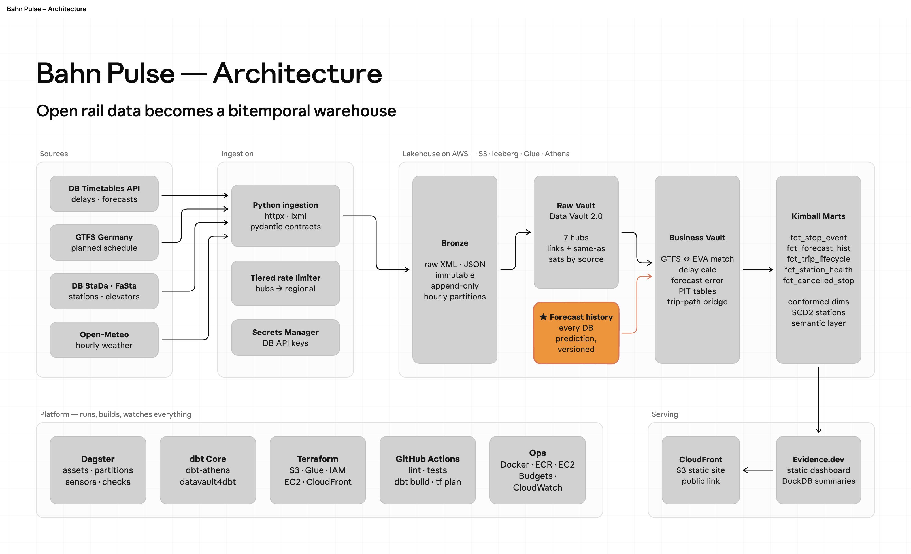

# Bahn Pulse

A bitemporal data warehouse for German rail.

Deutsche Bahn publishes a delay forecast for each train many times before it arrives.
Bahn Pulse stores every forecast version and measures how accurate those forecasts are,
and how the error shrinks as the train gets closer.

**Status:** work in progress. Full documentation follows once the pipeline runs.



## Development

```bash
uv sync
uv run pre-commit install
uv run pytest
```

## License

MIT, see [LICENSE](LICENSE). Data sources keep their own licenses.
